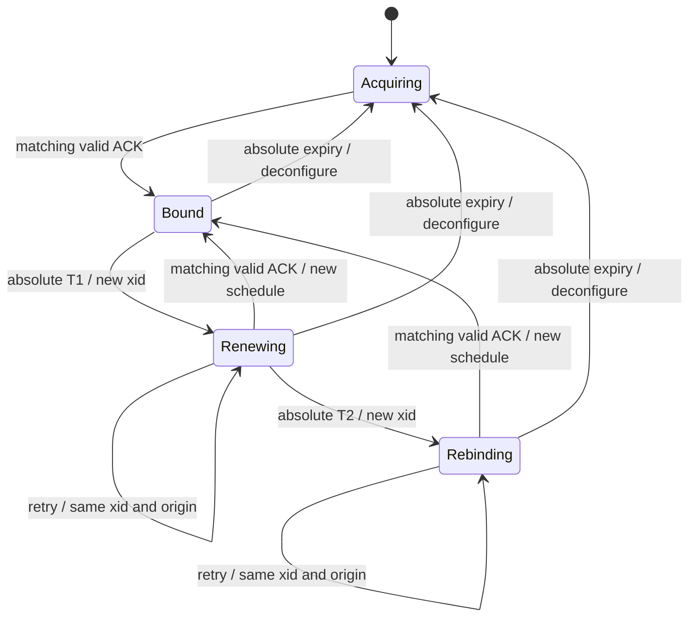
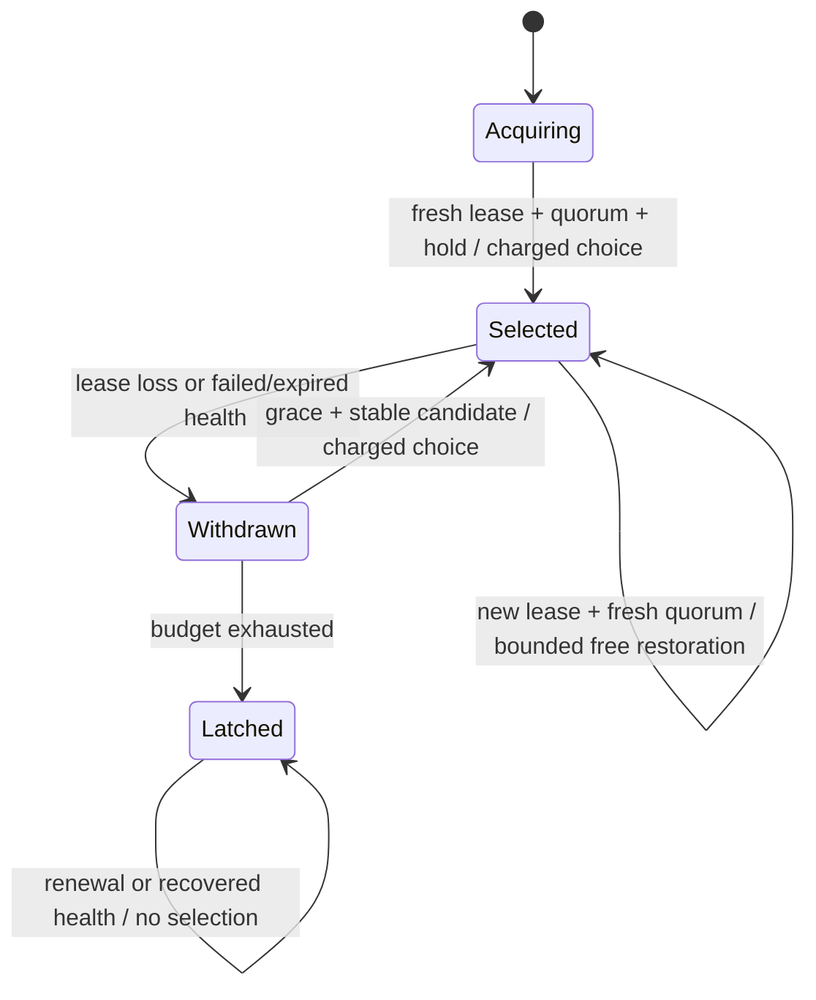

# MVP architecture

> Scope: this document describes the original static dual-uplink architecture.
> For the current dual-DHCP MVP, start with [installation](DHCP_INSTALL.md)
> and [installed-service lifecycle](DHCP_SYSTEMD.md). The modes are separate.

## Supported topology and ownership

One static routed IPv4 LAN, two different WAN subnets and a local management CLI.
The Linux kernel forwards packets. The privileged writer probes and checks
admission; the unprivileged worker proposes selections. Packets do not flow
through Python. No host-wide route, NAT or firewall is taken over.

Two fixed probe tables (41001/41002) and one active LAN table (41003) are reserved.
Local marked probes use explicit source/device bindings. Each probe lookup has a
matching terminal prohibit rule. Absence of a route must not fall through to main.
The priority-zero local rule stays intact. LAN selection requires both `iif` and
source prefix. Declared internal prefixes consult only non-default main routes,
then prohibit on lookup miss; unknown internal topology is not guessed.

After administrative link-up, the writer restores only missing owned probe and
connected routes. A selected route removed while its interface is observed down
becomes no selection; arbitrary disappearance while up blocks. External main-table
return routes remain the network provisioner's responsibility.

The backend rejects unknown/intersecting RPDB rules, duplicate/missing owned rules,
reserved-table conflicts, unexpected route state, absent sources, disabled
forwarding and unsupported effective strict reverse-path filtering. Only plain positive lookup rules with exactly priority/source/ingress/table
selectors and a disjoint non-loopback ingress are accepted unchanged. Inversion,
unknown selectors and actions block entry; all three standard built-in lookup
rules must exist uniquely. Other root processes can
still modify these objects; exclusive deployment ownership is a trust assumption.

## Health and selection

Per-link state: UNKNOWN -> RECOVERING -> HEALTHY, and on failed rounds
SUSPECT -> DOWN. Infrastructure errors, missing/expired rounds and boot changes
invalidate health. Results are bound to the config hash, boot ID and round ID.
Three configured TLS endpoints use 2-of-3 quorum. Three consecutive good/bad rounds
establish initial health/failure. These values are policy, not measured optimality.
Malformed JSON objects, non-object bodies, excessive nesting and non-finite
constants and optional peer strings exceeding 64 UTF-8 bytes are target failures,
not a reason to reject the complete sample or terminate the agent.
A target set can fail together and does not prove Internet-wide availability.

Selected route (A/B/none) is separate from automation status. Unknown is never a
new destination. Failure of the selected link permits a healthy alternative;
unknown current-link status alone does not trigger speculative switching.
Default failback is manual/non-preemptive. Optional automatic failback requires
continuous stable evidence. The admission budget allows three automatic selections
in 60 seconds, including initial admission; excess latches DEGRADED_LATCHED.
The latch preserves selection and keeps probing. Clearing it requires the
implemented root-only guarded resume with fresh health and an explicit budget
reset acknowledgement. It deliberately trades some availability for bounded mutation.

Freshness uses boot-relative time. Process restart rebuilds health and retains the
history/latch. Cross-boot events count conservatively until a full budget window
has elapsed in the new boot; restart is not free switching credit. No wall clock
is used for policy decisions. Thresholds are configurable through validated input.

Automatic selection carries a config/boot/round-bound health proof. The Writer
checks it after preflight/readback and again immediately before dispatch; helper
waiting is bounded by the remaining evidence lifetime. This does not guarantee
kernel completion before expiry or continued link health after dispatch. Recovery
reconstructs recorded intent without requiring old health to become fresh again.
The original core exploration driver retains `agent.cycle()` for fault injection.
The deployed MVP separately uses `worker.step()` and `control.Controller`; its
qualification runs both installed services and the formal operator CLI.

## Writer and recovery

One writer holds an exclusive non-symlink lock in a private state directory.
Mutation subprocesses inherit its descriptor. A live stopped writer or inherited
helper blocks a successor; no lease expiry grants concurrent mutation rights.
Epoch check, durable intent, the real ip operation, helper retirement/readback and
completion run within this ownership interval. A timeout is not proof of no effect.
The agent exits on an unknown write outcome; a successor must reconcile before work.

Within a boot, pending intent is reconciled against actual routes. If actual equals
before, the pending decision is abandoned without replaying old health. If actual
equals intended, completion is reconciled. A third state blocks mutation. After a
new boot destroys the namespace routes, the recorded layout and durable pending
selection (otherwise last selected route) are reconstructed, then fresh health is
collected; reconstruction does not certify reachability.

systemd restarts failures with a bounded rate. Exhausted restart limits require
intervention; no promise of automatic eventual recovery is made. The source unit
uses control-group cleanup, a five-second stop timeout and bounded capabilities.
The fixture substitutes only namespace, source/config/state and dependency paths;
external fault wrappers pause real Writer boundaries and are not the shipped agent.

## Service and operator boundary

The privileged daemon owns Writer and observations, with a bounded SOCK_SEQPACKET
UNIX socket. SO_PEERCRED accepts only root and the dedicated policy UID. Root-only
operator commands are separate from sample/automatic proposal operations. Every
operator change and automatic selection is checked against a process epoch and
a same-process revision. Startup recovery and owned-route maintenance instead operate under the
exclusive writer and reconcile checks; they do not accept a caller-selected target.
Automatic proposals
also carry the latest round; the writer independently recomputes admission from
its own observations. This keeps health forgery out of the unprivileged boundary.
The capability-free worker computes policy and proposes selections; it cannot
read the state DB or issue netlink writes. Trusted probe/admission validation
remains in the writer, rather than pretending it is a tiny untrusted syscall shim.

Service mode is independent from selected route and health:

- DISABLED: no attached owned layout. First daemon start is detached.
- Enable intent -> install/complete layout -> PAUSED, without selecting a WAN.
- PAUSED: probe and maintain owned layout, but do not select automatically.
- Resume: require fresh healthy explicit target and root acknowledgement of a
  recorded budget reset; select if needed, recheck freshness after persistence,
  then decide to enter ENABLED. The reply itself has no freshness deadline.
- ENABLED: admit healthy automatic proposals within the persistent budget.
- Disable intent -> remove validated owned objects -> DISABLED. The operator
  explicitly acknowledges handoff to the preexisting main policy.

Enable/disable intent is durable before any write. A successor completes partial
lifecycle work under the same inherited-lock discipline. Stop leaves routes intact;
restart retains modes and reconstructs fresh health. RPC loss does not undo a
completed mutation; clients must inspect status, never automatically retry with a
new token. Unknown mutation/storage outcomes terminate the writer for reconciliation.

## Capacity and remaining boundaries

Protocol packets, peer wait/backlog and probe rate are bounded. Events retain 128
rows and 32-KiB payloads; budget history retains only relevant admission entries
and rejects more than 64. The SQLite main DB has 2048 4-KiB pages; rollback files
and system journald are separate resource domains. A low-space check is a guard,
not a filesystem quota or guarantee against concurrent disk exhaustion.

See [operations](OPERATIONS.md) for exact limits and deployment prerequisites.
Root writer compromise remains outside the boundary; namespace capabilities are
broad. No storage corruption repair, remote fleet control, HA, distribution package
qualification, physical WAN result or recovery-time guarantee is established.

## Optional single DHCP uplink

The [DHCP lifecycle](DHCP.md) is a separate controller and journal. It owns dedicated
41101/41103 tables and a supervised BusyBox client. It does not alter the static
A/B controller or share its health, switch budget or authority. Every lease update
invalidates health; restart quarantines persisted allocations before a new client
session. Integration of dynamic links into dual-uplink failover remains future work.

## Dual-DHCP exploration architecture

The [dual-DHCP exploration](DUAL_DHCP.md) uses a separate formal core/backend with
tables 41201/41202/41203. It is not two single-DHCP daemons and is not integrated
into either existing installed service. Local lease mutations and shared LAN
selection are distinct. Per-link client authority and health generations cannot
be replaced by a global callback revision; writer epoch/global selection revision
are a separate fence. Inactive renewal must preserve the other active route.

DHCP-bound local unicast and marked probes each have a per-WAN lookup plus a
terminal prohibit. Raw discovery/rebinding needs separate client/interface
qualification. New admission requires fresh HEALTHY; stale/unknown health and
invalid leases require withdrawal even while paused/latched. Required withdrawal
has no health-admission deadline, though helper timeout can still force recovery.
Valid callback completion services expiry; rejected old callbacks are readonly.
No hard scheduling bound follows from the synchronous core API.

Process/boot recovery quarantines all known old/new DHCP allocations rather than
reconstructing a static selected route. A client-only restart invalidates only its
own authority; the fixture orchestrates that restart, not a shipped supervisor.
Before a dual service MVP, bounded event intake, actual per-client supervision,
exact lease-time origin, automatic non-preemptive selection and operator recovery
must pass the additional gates in [the exploration contract](DUAL_DHCP.md).

## Formal dual-DHCP stage-one runtime

[Stage one](DHCP_STAGE1.md) adds root-local bounded intake and actual independent
BusyBox supervision around that core/backend. Probe rounds run off the writer
thread and remain generation/time bound. DHCP hook authority/time is fixed before
queuing; per-session intake sequence is durable and is never replaced with a
newer core revision at delivery. Each link has reserved finite queue slots.
Overflow/missing current wire evidence causes link-local retirement, not presumed
health or retries with newer identity. Root may explicitly choose a healthy link;
no automatic selection loop is present.

An AF_PACKET observer establishes a conservative original-REQUEST time lower
bound from the last proven-empty receive queue and matches ACK to hook allocation.
Queued events keep that bound; processing cannot add a full lease at delivery.
Within a capture session, reused xids retain the earliest bound and immutable
ACK semantics. Conflicting evidence invalidates even already-claimed queued
proofs; bounded history cannot evict that protection. Legitimate same-xid renewals
therefore cannot extend validity. Rejected expired hooks request link-local
reacquisition under the existing restart limiter, without automatic reselection.
Unclaimed new allocation evidence invalidates prior health. This can shorten
availability and is not exact packet timing or a hard cleanup deadline. Clients,
listener, probe workers and writer share the trusted root runtime; this is not
the static service's separate unprivileged policy-worker design.

## Renewable client exploration (historical P0)

[P0](DHCP_P0.md) selects an experimental external BusyBox build explicitly.
Process-local nonrepeating xids provide a new transaction boundary; the writer
continues to require matching wire evidence and fixed hook authority. The first-seen REQUEST watermark retires prior unanswered transactions too;
known superseded xids cannot reopen after a later request. A new REQUEST alone
does not withdraw an unexpired allocation. New transactions may extend deadlines;
same-xid ambiguity remains fail-closed. The default distro client is unchanged.
The build is separately GPL-governed and is not bundled with the MIT package.
The historical P0 client did not qualify negotiated DHCP options 58/59. Automatic selection, privilege separation and installed dual-DHCP
service recovery remain later MVP gates.

## REQUEST-origin absolute timers

The [current explicit client adapter](DHCP_TIMERS.md) uses the exact C schedule
embedded by the external build. ACK options establish absolute BOOTTIME T1, T2
and expiry from the first REQUEST origin. T1 and T2 each begin a new xid; retries
retain that xid/origin. Missing options use half/seven-eighths defaults; malformed
or inconsistent values cannot replace a live lease. Retry-count exhaustion no
longer ends that lease. At expiry the client deconfigures and the writer separately
withdraws its owned allocation. The hook's fixed client origin can only shorten
the independent capture-derived deadline. This remains a bounded foreground
integration, not the installed dual-DHCP automatic-failover MVP.

Invalid timer ACKs do not reset the schedule; superseded ACKs cannot reopen an
older transaction. Restart starts a new authority and requires acquisition and
fresh health; this diagram does not establish reboot or power-loss qualification.

The explicit timer client attaches a mandatory narrow cBPF receive filter to its
packet socket. Its supported IPv4/IHL5, unfragmented UDP 67→68 profile excludes
unrelated IPv4 traffic before queueing; attach failure exits. The Linux review
compares equal-buffer filtered/unfiltered sockets on one actual burst, and
separately tests the real client processing a delayed ACK after quarantine while
the ordinary kernel UDP path is blocked. This is not protection against arbitrary
DHCP floods or a proof of every receive interleaving.

## P0 selected-WAN convergence

[Convergence](DHCP_CONVERGENCE.md) adds an opt-in runtime restoration target armed
only by successful explicit selection. A journalled link/generation anchor
authorizes one restoration for a newer lease generation on that same WAN. Fresh
health and completed ACK admission remain required. Manual choose still consumes
budget; automatic same-WAN lease restoration does not. A separate 16/60-second
dispatch bound and one-success-per-generation guard bound retries. Pause/latch
blocks restoration, not safety withdrawal. Writer reopen clears the anchor and
runtime intent while preserving budget; no old DHCP health is restored.

## Milestone 1: automatic dual-DHCP selection

[Automatic mode](DHCP_AUTOMATIC.md) adds healthy-candidate hold, withdrawal grace
and sticky non-preemptive selection to the formal runtime. Initial/cross-WAN and
same-generation reselection use the lifecycle's charged `choose`; same-WAN new
lease recovery uses bounded `restore`. Both paths respect pause/latch and intake
fences before/after the actual write. Observed concurrent ACK/loss invalidates and
withdraws before publication; the final check is not atomic with future packets.

The renewal self-transition includes real quarantine/withdrawal; it does not mean
continuous forwarding. No automatic failback is enabled. Foreground policy-process
separation and operator controls are added by the next slice below; installed recovery
for this mode has a separate qualification below.

## Dual-DHCP policy/operator boundary

[The control slice](DHCP_CONTROL.md) adds a separate capability-free proposal client
and root operator socket. Root writer-owned candidate computation and live
admission remain authoritative; worker clocks/proofs/commands are not accepted.
SO_PEERCRED distinguishes the dedicated policy UID from root operations. The
private client-event channel is separate. Proposal and operator queues have
independent bounds; absent policy never grants inline charged selection.

Pause, explicit reset-budget and resume carry epoch/revision/operation ID. Reset
never resumes. Fresh lease/health and post-persistence checks gate resume; later
actual selection still requires hold/grace/budget. The journal holds 32 bounded
operator receipts alongside state, with explicit migration of known old schemas.
Entering latch advances revision. This is foreground separation, not installed
process-tree or reboot recovery qualification; DHCP clients/capture remain trusted.

## Installed dual-DHCP lifecycle

The [dual service units](DHCP_SYSTEMD.md) are separate from static/single-DHCP
deployments. The writer uses Type=notify only after production quarantine,
capture/listener/client setup and status publication. After= ordering delays the
unprivileged policy unit until that readiness point, not until a usable WAN.
KillMode=control-group and a post-stop invocation of the same exclusive recovery
core remove the previous process tree and allocations before replacement. The
post-stop core preserves journal limits and operator state; it does not spawn
clients. Startup then advances authority again and admits only new DHCP/health.

Normal stop withdraws DHCP routing and keeps terminal RPDB guards; pause preserves
a still-safe selected path. A crash leaves a supervision/cleanup interval, not
continuous userspace safety enforcement. Bounded restart exhaustion requires
explicit service-manager repair and never resets the application switch budget.
One test-only pre-exec ip delay observes inherited-lock ownership and cgroup kill
before takeover; this is not evidence for every helper failure or escaped root
process. Installed orderly VM reboot has a separate [qualification](DHCP_BOOT.md). Bounded storage-exhaustion
safety now has its own [qualification](DHCP_STORAGE.md).

## Dual-DHCP storage-failure exit

Persistence failure retires the writer and rejects further selection. A failed
API is never acknowledged as successful even when emergency withdrawal succeeds.
The non-durable withdrawal uses the same exclusive flock and scoped backend,
combining validated last-durable ownership with in-memory mutation intents. No
initial durable snapshot means no inferred ownership. Foreign scope or lock
contention refuses mutation. Existing terminal guards remain in place; no main
routes or other tools' rules are changed. Receipts explicitly mark durable=false.

Repair starts a new writer; it must durably save a new epoch before readiness,
and acquire fresh leases/health before forwarding. Pause/latch, switch budget
history and operation receipts survive. Root-only storage page limits can be
changed on restart without changing route authority identity; all route-related
configuration remains bound. See [contract and limits](DHCP_STORAGE.md).

## Installed dual-DHCP cross-boot handoff

The [orderly VM boot gate](DHCP_BOOT.md) separates durable policy from volatile
lease/health evidence. The unchanged production recovery entry point advances
persisted epoch before readiness and rebuilds client sessions; no old ACK or
health result authorizes a new selection. Old boot switch history is retained
conservatively because boot-time clocks are not comparable. Pause and latch need
explicit operator transitions; reboot is not a budget reset.

A fixture-only prerequisite service reconstructs isolated interfaces/return paths
and reads the pre-Agent journal. It does not restore product routing or journal
state. Normal shutdown and a separately labelled cleanup-bypass case establish
different evidence: only the latter challenges recovery with old durable active
allocations still present. ENOSPC is carried through one normal VM stop/start on
the same ext4 image. No boot-zero-gap or sudden power-loss property is inferred.
